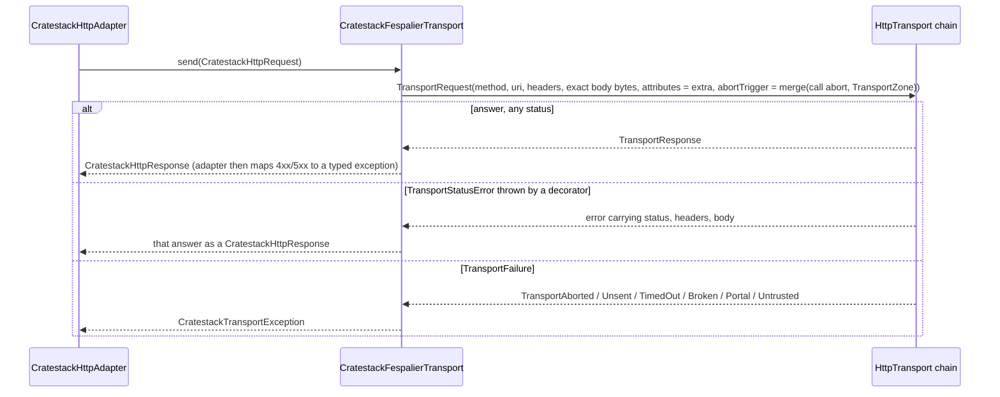

# The `fespalier` preset

*(Since 0.16.0, [cratestack#1204](https://github.com/cratestack/cratestack/issues/1204).)*

`--preset fespalier` is the [`riverpod` preset](/guides/dart-client-generation#the-riverpod-preset) sending through [fespalier](https://github.com/fespalier/fespalier)'s `HttpTransport` (`package:fespalier_transport`) instead of Dio. An app builds its transport chain once, for example `SessionTransport(… HttpClientTransport(client))`, and every generated call sends through it, so whatever the chain does (a session, request signing, a write guard, spans) applies to the generated client with no Dio in front of it.

It sits on the [HTTP transport seam](/guides/dart-http-transport): `CratestackFespalierTransport` is one more implementation of `CratestackHttpTransport`, and the generated `CratestackHttpAdapter` / `CratestackRpcHttpAdapter` do the codec work above it.

```bash
cratestack generate-dart \
  --schema server/schema.cstack \
  --out client \
  --library-name orders_client \
  --preset fespalier \
  --run-build-runner
```

| Flag | Notes |
|---|---|
| `--preset fespalier` | Selects the preset. REST and RPC schemas are both supported. |
| `--fespalier-ref <REF>` | The git tag, branch or commit of `github.com/fespalier/fespalier` that the generated pubspec pins `fespalier_transport` at (and, *(since 0.19.7, unreleased on main)*, `fespalier_auth`, `fespalier_keypair` and `fespalier_sign_keypair` when the schema uses `@device_auth`). Defaults to `v0.21.0`, the fespalier release this CrateStack targets. An error with any other preset, or if the value is empty or holds whitespace. |

## What is different from `riverpod`

Everything else is the `riverpod` preset's, file for file. Only these differ:

- **No Dio.** The preset does not emit `lib/src/dio_transport.dart`, and its pubspec has no `dio`.
- **`lib/src/fespalier_transport.dart`** holds `CratestackFespalierTransport`, the adapter from `HttpTransport` to the generated `CratestackHttpTransport` seam.
- **A git dependency.** `fespalier_transport` is not on pub.dev. fespalier packages are git dependencies by design, so the pubspec pins it by git at the `--fespalier-ref`:

  ```yaml
  fespalier_transport:
    git:
      url: https://github.com/fespalier/fespalier
      path: packages/fespalier_transport
      ref: 'v0.21.0'
  ```

  The pinned ref must be reachable for the package to resolve. Where it is not (an unreleased fespalier), point `fespalier_transport` at a local checkout with a `pubspec_overrides.yaml`.
- **Two providers the app overrides**, and a changed default for the adapter provider (below).
- The generated README gains a fespalier section, and the barrel export, `client.dart` and the adapter-construction doc comments in `runtime.dart` change to match.

## The providers

`<prefix>` is the library name in camel case: `--library-name orders_client` gives `ordersClient`.

| Provider | Type | Default |
|---|---|---|
| `<prefix>TransportProvider` | `Provider<HttpTransport>` | Throws an instructive `UnimplementedError` until the app overrides it. |
| `<prefix>BaseUriProvider` | `Provider<Uri>` | Throws an instructive `UnimplementedError` until the app overrides it. |
| `<prefix>AdapterProvider` | `Provider<CratestackClientAdapter>` (`CratestackRpcAdapter` for RPC) | `CratestackHttpAdapter` / `CratestackRpcHttpAdapter` over `CratestackFespalierTransport(ref.watch(<prefix>TransportProvider))`. Override it only to change the wire format or to use another adapter. |
| `<prefix>BasePathProvider` | `Provider<String>` (REST only) | Unchanged from `riverpod`: the path prefix of the request. |
| `<prefix>ClientProvider` | the generated client | Unchanged. |

`<prefix>BaseUriProvider` is the server's origin, with an optional path prefix (`https://api.example.com` or `https://example.com/v1`). `<prefix>BasePathProvider` is the API path prefix of the request. They are different things.

The app overrides the first two once, at the root:

```dart
ProviderScope(
  overrides: [
    ordersClientTransportProvider.overrideWith(
      (ref) => SessionTransport(
        WriteGuardTransport(HttpClientTransport(client)),
        ref.watch(credentialsProvider),
      ),
    ),
    ordersClientBaseUriProvider.overrideWithValue(
      Uri.parse('https://api.example.com'),
    ),
  ],
  child: const MyApp(),
)
```

Built by hand, outside Riverpod, the same wiring is:

```dart
final adapter = CratestackHttpAdapter(
  CratestackFespalierTransport(
    SessionTransport(WriteGuardTransport(HttpClientTransport(client)), credentials),
  ),
  baseUri: Uri.parse('https://api.example.com'),
);
```

(`CratestackRpcHttpAdapter` for a `transport rpc` schema.)

## What `CratestackFespalierTransport` does



- **The request** goes out with the exact body bytes the adapter encoded (a signer layered above the transport sees those and nothing else), the headers, and `CratestackHttpRequest.extra` as `TransportRequest.attributes`. Attributes are never sent on the wire.
- **The abort is merged.** The call option's `abort` and the abort trigger of the current `TransportZone` are combined with `TransportZone.merge`, and either one aborts. That is how `ref.cancellable` in `fespalier_cratestack` aborts a page's loads with no extra wiring, even for a call that carries its own `abort`.
- **Every status is an answer.** A `TransportStatusError` thrown by a decorator that wraps error answers in exceptions is treated as the answer it carries, so it still becomes `CratestackRestException` or `CratestackRpcException`.
- **Failures map onto the seam's kinds:**

  | fespalier | CrateStack |
  |---|---|
  | `TransportAborted` | `CratestackTransportAborted` |
  | `TransportUnsent` | `CratestackTransportUnsent` |
  | `TransportTimedOut` | `CratestackTransportTimedOut` |
  | `TransportBroken` | `CratestackTransportBroken` |
  | `TransportPortal` | `CratestackTransportBroken`, `cause` is the original failure |
  | `TransportUntrusted` | `CratestackTransportBroken`, `cause` is the original failure |

  The seam has no kind for a captive portal or an untrusted network, so those two become `CratestackTransportBroken`. Check `error.cause is TransportPortal` (or `TransportUntrusted`) to tell them apart.
- **Any other error a decorator throws reaches the caller unchanged.** `AuthRejected` is the example: it is not a transport failure, so the adapter does not rewrap it.

## Worked example

fespalier's [`examples/cratestack`](https://github.com/fespalier/fespalier/tree/main/examples/cratestack) is a small orders app that puts this preset together with device-signed sessions (`fespalier_sign_keypair`): no password, no token and no `Authorization` header. It has:

- a standalone Rust server whose `schema.cstack` is the contract, with public enrolment procedures and signed ones that it verifies on every other request;
- the Flutter client that `cratestack generate-dart --preset fespalier` wrote from that schema, committed, linking no Dio;
- an app whose startup builds the transport chain once and overrides `<prefix>TransportProvider` and `<prefix>BaseUriProvider` with it;
- tests on both sides and a cross-language end-to-end test where Dart signs and Rust verifies.

Its README has the sequence and state diagrams for enrolment, renewal and sign-in. fespalier's [CrateStack and fespalier](https://github.com/fespalier/fespalier/blob/main/docs/cratestack.md) page is the wiring reference.

## Device ceremonies (`@device_auth`)

*(Since 0.19.7, unreleased on main, [cratestack#1303](https://github.com/cratestack/cratestack/issues/1303).)* A schema that marks the device-enrolment procedures with `@device_auth` gets `lib/src/device_auth_server.dart`, exported from the library: `<Prefix>DeviceAuthServer implements DeviceAuthServer` (`package:fespalier_sign_keypair`) over the generated client, so an app no longer hand-writes that class. Only `--preset fespalier` reads the marker. The `default` and `riverpod` presets, the TypeScript, WireMock and Rust clients and the macros (server, client and embedded) ignore it, and their output is byte-identical with and without it. MCP is not affected.

### The marker and its roles

`@device_auth(role: "<role>")` goes on a top-level `procedure` or `mutation procedure`. Each marked procedure is one leg of a device's enrolment, renewal or revocation. The role names are the method names of fespalier's `DeviceAuthServer`:

| `role` | `DeviceAuthServer` method | Required | Policy |
| --- | --- | --- | --- |
| `beginEnrolment` | `beginEnrolment(EnrolmentStart)` | yes | exactly `@allow(true)` |
| `confirmEnrolment` | `confirmEnrolment(challenge, signatures, proof)` | yes | exactly `@allow(true)` |
| `beginRenewal` | `beginRenewal(deviceId, role)` | yes | exactly `@allow(true)` |
| `confirmRenewal` | `confirmRenewal(challenge, signature)` | yes | exactly `@allow(true)` |
| `revoke` | `revoke(credential, signer)` | yes | **must not be public**: `@allow(true)` is a parse error |
| `sendEnrolmentCode` | an extra method on the class, not in the interface | no | exactly `@allow(true)` |

- **All or nothing.** If any marker is present, the five required roles must all be present: `DeviceAuthServer` cannot be implemented partially. Each role is on one procedure, and a procedure carries one marker.
- **Public means exactly `@allow(true)`** (whitespace aside), with no `@deny`, `@authn` or `@authorize`: a device has no session when it calls a public leg. `revoke` is the opposite. The device signs it, and a public `revoke` would let anyone revoke any device by its id, so give it a policy that needs the signed session, such as `@allow(auth() != null)`.
- **Not allowed on** a model, field, `type`, `query` or `view`, on a subscription procedure, or together with `@stream`.
- `proof: "<field>"` is a second key, on `confirmEnrolment` only (see [the one-time code](#the-one-time-code)).

### Shapes the generator maps

Every leg takes one `type` argument and returns one `type` (not a list, an optional or a model). Fields are matched by name. The parser checks all of this at the marker, so a leg whose field the generator would drop is refused rather than emitted.

- **`beginEnrolment`** takes `ambient`, a JWK `type` of exactly `kty`, `crv`, `x`, `y` (each `String`), and optionally `userPresent` (`Jwk?`). Every other field is `String` or `String?` and is read from `EnrolmentStart.fields[name]`. It returns `ambient` (`String`), `userPresent` (`String?`, present exactly when the input has it) and any other `String` fields, which go to `EnrolmentChallenge.data`.
- **`confirmEnrolment`** takes `ambient` (`String`), `userPresent` (`String?`, only if above has it), optionally the `proof:` field, and otherwise only fields that `beginEnrolment` returned, with the same name and type (read back from `challenge.data`). It returns `deviceId`, `userId`, `ambient`, `userPresent` (`String?`), optionally `name` and `email`; other `String` fields go to `AuthUser.claims`.
- **`beginRenewal`** takes exactly `deviceId` and `role` (`String`) and returns `challenge` (`String`), plus extra `String` fields for `RoleChallenge.data`.
- **`confirmRenewal`** takes `signature` plus fields echoing what `beginRenewal` returned, and returns `attestation` (`String`).
- **`revoke`** takes exactly `deviceId` (`String`) and may return anything.
- The user-present key is in all four enrolment shapes or in none.

### A worked schema

This is the shape of the ceremonies in fespalier's `examples/cratestack` (types reduced to the fields that matter):

```cstack
type Jwk { kty String  crv String  x String  y String }

type BeginEnrolmentArgs { phone String  otp String  ambient Jwk  userPresent Jwk? }
type EnrolmentChallenges { enrolmentId String  ambient String  userPresent String? }
type ConfirmEnrolmentArgs { enrolmentId String  ambient String  userPresent String? }
type EnrolledDevice { deviceId String  userId String  phone String  ambient String  userPresent String? }
type BeginRenewalArgs { deviceId String  role String }
type RenewalChallenge { challengeId String  challenge String }
type ConfirmRenewalArgs { challengeId String  signature String }
type Renewed { attestation String }
type RevokeArgs { deviceId String }
type Revoked { deviceId String }

mutation procedure beginEnrolment(args: BeginEnrolmentArgs): EnrolmentChallenges
  @device_auth(role: "beginEnrolment")
  @allow(true)

mutation procedure confirmEnrolment(args: ConfirmEnrolmentArgs): EnrolledDevice
  @device_auth(role: "confirmEnrolment")
  @allow(true)

mutation procedure beginRenewal(args: BeginRenewalArgs): RenewalChallenge
  @device_auth(role: "beginRenewal")
  @allow(true)

mutation procedure confirmRenewal(args: ConfirmRenewalArgs): Renewed
  @device_auth(role: "confirmRenewal")
  @allow(true)

mutation procedure revokeDevice(args: RevokeArgs): Revoked
  @device_auth(role: "revoke")
  @allow(auth() != null)
```

Here `phone` and `otp` reach the server as `EnrolmentStart.fields['phone']` and `['otp']`; `enrolmentId` travels from leg one to leg two through `EnrolmentChallenge.data`; `phone` in `EnrolledDevice` lands in `AuthUser.claims`.

### Wiring the generated class

```dart
final backend = DeviceAuthBackend(
  server: DeviceAuthRestClientDeviceAuthServer(   // <Prefix>DeviceAuthServer
    transport,                                    // AuthConfig.transport: no session on it
    baseUri: Uri.parse('https://api.example.com'),
    fieldErrors: errors.fieldErrorsOf,            // optional
  ),
  keys: DeviceKeys.device(),
  profile: const DeviceSignatureProfile(audience: 'https://api.example.com'),
);
```

The constructor is `(transport, {required baseUri, basePath = '/api' (REST only), fieldErrors, userOf})`.

- **`transport`** is `AuthConfig.transport`, the chain with no session on it, so the unsigned legs go out unsigned by construction. If you pass a transport that signs instead, give `DeviceAuthBackend(unsignedPaths: <Prefix>DeviceAuthServer.unsignedPaths(baseUri))`, which lists the unsigned legs' paths (the four required ones, plus `sendEnrolmentCode` when it is marked; REST `<basePath>/$procs/<name>`; RPC `/rpc/procedure.<name>`).
- **`fieldErrors`** (`Object? Function(Object)?`) turns an error answer into a form's field errors; pass `errors.fieldErrorsOf`. It is a callback so the generated package depends on neither `fespalier` nor `fespalier_cratestack`.
- **`userOf`** (`AuthUser Function(<confirmEnrolment return type>)?`) builds the `AuthUser` yourself. By default `userId` is the id, `name` and `email` are those fields, and every other field is in `claims`.
- A **`403`** on `beginRenewal`, `confirmRenewal` and `confirmEnrolment` is an `AuthRejected`. It is not mapped on `beginEnrolment` or `revoke`; every other failure is thrown as it is.
- **`revoke`** is signed by the device, through a private signing transport built over the `DeviceSigner` it is handed.
- REST and RPC are both generated.

### The one-time code

A server that checks a one-time code can receive it in either of two places:

- **With leg one.** The code is an ordinary `String` field of the `beginEnrolment` argument, read from `fields['otp']`. Authkestra works this way. Mark a procedure `@device_auth(role: "sendEnrolmentCode")` and the class gets an extra `sendEnrolmentCode` method (not in the interface) that asks the server to send the code before leg one.
- **With leg two.** Name the field on `confirmEnrolment`: `@device_auth(role: "confirmEnrolment", proof: "otp")`. The field (`String` or `String?`) receives the proof. Without `proof:` the proof is ignored.

### Pubspec and SDK floor

A generated package that uses the marker also depends, by git at the same `--fespalier-ref` as `fespalier_transport`, on `fespalier_auth`, `fespalier_keypair` and `fespalier_sign_keypair`, and its SDK floor is Dart `>=3.12` and Flutter `>=3.44`, which `fespalier_sign_keypair` requires. One ref is the only one that resolves, because `fespalier_sign_keypair` pins its siblings at its own tag. The default ref stays `v0.21.0`: `DeviceAuthServer` is byte-identical from v0.21.0 through v0.26.0.

### Errors and tooling

Every parse error points at the marker line: an unknown role or key, two markers on one procedure, a role on two procedures, a missing required role ("... but not `revoke`: the device roles are all-or-nothing"), a non-public leg, "`revoke` must not be public", a shape mismatch ("has no `ambient`; it needs a required JWK", "has no source"). `@deviceAuth` is refused with "did you mean `@device_auth`?". `cratestack check` and the language server report them; the language server also completes `@device_auth` and shows the role on hover. `print-ir` lists the marker among a procedure's `attributes`. The marker is outside every per-operation contract digest, so no COSE AAD changes, and inside the whole-schema identity `x-cratestack-schema-sha`.

## Known gaps

- On 0.16.0–0.19.5, a generated call could not hand the transport chain a per-call attribute ([cratestack#1207](https://github.com/cratestack/cratestack/issues/1207)); *(since 0.19.6)* `CratestackCallOptions.extra` and `CratestackRpcCallOptions.extra` now populate `CratestackHttpRequest.extra`, which `CratestackFespalierTransport` forwards as `TransportRequest.attributes`.
- On 0.17.0 and earlier, an `AuthProvider` refusal cannot carry a machine-readable reason in its body, so a client cannot tell "renew the attestation" from "wipe the keys" by a body member. *(Since 0.17.1, [cratestack#1208](https://github.com/cratestack/cratestack/issues/1208).)* `AuthRefusal` adds such members next to `code` and `message` (see [Refusing a request](/guides/auth-provider#refusing-a-request)). A fespalier `RequestAuthenticator` reads them from the raw response, before the generated client decodes it. The generated client types them too *(since 0.17.1, [cratestack#1243](https://github.com/cratestack/cratestack/issues/1243))*: `CratestackRestException` and `CratestackRpcException` both expose `code`, `message`, `details`, `extra` (every other member) and `challenges` (the `WWW-Authenticate` value), and `RpcErrorBody.extra` no longer drops a member. See [Reading a refusal in a generated client](/guides/auth-provider#reading-a-refusal-in-a-generated-client). A step-up refusal is typed as `stepUp` (a `StepUpRequired`) on both exceptions, and `retryAfterStepUp` sends a call again at most once after a re-proof *(since 0.17.1, [cratestack#1244](https://github.com/cratestack/cratestack/issues/1244))*, so a fespalier session can map it; see [A step-up refusal in a generated client](/guides/auth-provider#a-step-up-refusal-in-a-generated-client).
- *(Since 0.19.7, unreleased on main, [cratestack#1303](https://github.com/cratestack/cratestack/issues/1303).)* Each generated device-auth call runs in a `TransportZone` with an abort trigger that never fires. This is a workaround for a suspected, unconfirmed `fespalier_auth` issue (a page leaving might abort a renewal shared by every waiting request); it is documented in the generated code.

## See also

- [Dart HTTP transport](/guides/dart-http-transport) — the seam, the adapters, typed errors and call options this preset builds on
- [Auth support matrix](/reference/auth-support-matrix#device-ceremonies-device-auth) — where `@device_auth` sits among procedure attributes
- [Dart client generation](/guides/dart-client-generation) — presets and flags
- [Migrating the Dart client to the HTTP transport](/overview/migrating-dart-http-transport)
