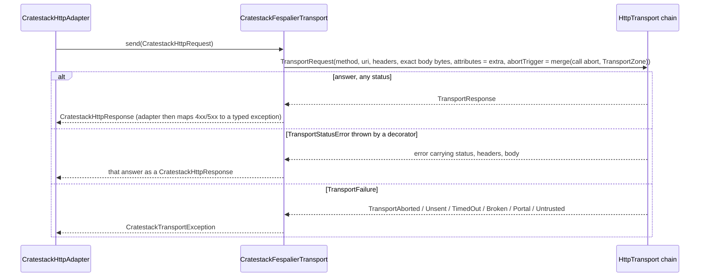

# The `fespalier` preset

*(Unreleased, [cratestack#1204](https://github.com/cratestack/cratestack/issues/1204).)*

`--preset fespalier` is the [`riverpod` preset](/guides/dart-client-generation#the-riverpod-preset) sending through [fespalier](https://github.com/fespalier/fespalier)'s `HttpTransport` (`package:fespalier_transport`) instead of Dio. An app builds its transport chain once, for example `SessionTransport(… HttpClientTransport(client))`, and every generated call sends through it, so whatever the chain does (a session, request signing, a write guard, spans) applies to the generated client with no Dio in front of it.

It sits on the [HTTP transport seam](/guides/dart-http-transport): `CratestackFespalierTransport` is one more implementation of `CratestackHttpTransport`, and the generated `CratestackHttpAdapter` / `CratestackRpcHttpAdapter` do the codec work above it.

```bash
cratestack generate-dart \
  --schema server/schema.cstack \
  --out client \
  --library-name orders_client \
  --preset fespalier \
  --run-build-runner
```

| Flag | Notes |
|---|---|
| `--preset fespalier` | Selects the preset. REST and RPC schemas are both supported. |
| `--fespalier-ref <REF>` | The git tag, branch or commit of `github.com/fespalier/fespalier` that the generated pubspec pins `fespalier_transport` at. Defaults to `v0.21.0`, the fespalier release this CrateStack targets. An error with any other preset, or if the value is empty or holds whitespace. |

## What is different from `riverpod`

Everything else is the `riverpod` preset's, file for file. Only these differ:

- **No Dio.** The preset does not emit `lib/src/dio_transport.dart`, and its pubspec has no `dio`.
- **`lib/src/fespalier_transport.dart`** holds `CratestackFespalierTransport`, the adapter from `HttpTransport` to the generated `CratestackHttpTransport` seam.
- **A git dependency.** `fespalier_transport` is not on pub.dev. fespalier packages are git dependencies by design, so the pubspec pins it by git at the `--fespalier-ref`:

  ```yaml
  fespalier_transport:
    git:
      url: https://github.com/fespalier/fespalier
      path: packages/fespalier_transport
      ref: 'v0.21.0'
  ```

  The pinned ref must be reachable for the package to resolve. Where it is not (an unreleased fespalier), point `fespalier_transport` at a local checkout with a `pubspec_overrides.yaml`.
- **Two providers the app overrides**, and a changed default for the adapter provider (below).
- The generated README gains a fespalier section, and the barrel export, `client.dart` and the adapter-construction doc comments in `runtime.dart` change to match.

## The providers

`<prefix>` is the library name in camel case: `--library-name orders_client` gives `ordersClient`.

| Provider | Type | Default |
|---|---|---|
| `<prefix>TransportProvider` | `Provider<HttpTransport>` | Throws an instructive `UnimplementedError` until the app overrides it. |
| `<prefix>BaseUriProvider` | `Provider<Uri>` | Throws an instructive `UnimplementedError` until the app overrides it. |
| `<prefix>AdapterProvider` | `Provider<CratestackClientAdapter>` (`CratestackRpcAdapter` for RPC) | `CratestackHttpAdapter` / `CratestackRpcHttpAdapter` over `CratestackFespalierTransport(ref.watch(<prefix>TransportProvider))`. Override it only to change the wire format or to use another adapter. |
| `<prefix>BasePathProvider` | `Provider<String>` (REST only) | Unchanged from `riverpod`: the path prefix of the request. |
| `<prefix>ClientProvider` | the generated client | Unchanged. |

`<prefix>BaseUriProvider` is the server's origin, with an optional path prefix (`https://api.example.com` or `https://example.com/v1`). `<prefix>BasePathProvider` is the API path prefix of the request. They are different things.

The app overrides the first two once, at the root:

```dart
ProviderScope(
  overrides: [
    ordersClientTransportProvider.overrideWith(
      (ref) => SessionTransport(
        WriteGuardTransport(HttpClientTransport(client)),
        ref.watch(credentialsProvider),
      ),
    ),
    ordersClientBaseUriProvider.overrideWithValue(
      Uri.parse('https://api.example.com'),
    ),
  ],
  child: const MyApp(),
)
```

Built by hand, outside Riverpod, the same wiring is:

```dart
final adapter = CratestackHttpAdapter(
  CratestackFespalierTransport(
    SessionTransport(WriteGuardTransport(HttpClientTransport(client)), credentials),
  ),
  baseUri: Uri.parse('https://api.example.com'),
);
```

(`CratestackRpcHttpAdapter` for a `transport rpc` schema.)

## What `CratestackFespalierTransport` does



- **The request** goes out with the exact body bytes the adapter encoded (a signer layered above the transport sees those and nothing else), the headers, and `CratestackHttpRequest.extra` as `TransportRequest.attributes`. Attributes are never sent on the wire.
- **The abort is merged.** The call option's `abort` and the abort trigger of the current `TransportZone` are combined with `TransportZone.merge`, and either one aborts. That is how `ref.cancellable` in `fespalier_cratestack` aborts a page's loads with no extra wiring, even for a call that carries its own `abort`.
- **Every status is an answer.** A `TransportStatusError` thrown by a decorator that wraps error answers in exceptions is treated as the answer it carries, so it still becomes `CratestackRestException` or `CratestackRpcException`.
- **Failures map onto the seam's kinds:**

  | fespalier | CrateStack |
  |---|---|
  | `TransportAborted` | `CratestackTransportAborted` |
  | `TransportUnsent` | `CratestackTransportUnsent` |
  | `TransportTimedOut` | `CratestackTransportTimedOut` |
  | `TransportBroken` | `CratestackTransportBroken` |
  | `TransportPortal` | `CratestackTransportBroken`, `cause` is the original failure |
  | `TransportUntrusted` | `CratestackTransportBroken`, `cause` is the original failure |

  The seam has no kind for a captive portal or an untrusted network, so those two become `CratestackTransportBroken`. Check `error.cause is TransportPortal` (or `TransportUntrusted`) to tell them apart.
- **Any other error a decorator throws reaches the caller unchanged.** `AuthRejected` is the example: it is not a transport failure, so the adapter does not rewrap it.

## Worked example

fespalier's [`examples/cratestack`](https://github.com/fespalier/fespalier/tree/main/examples/cratestack) is a small orders app that puts this preset together with device-signed sessions (`fespalier_sign_keypair`): no password, no token and no `Authorization` header. It has:

- a standalone Rust server whose `schema.cstack` is the contract, with public enrolment procedures and signed ones that it verifies on every other request;
- the Flutter client that `cratestack generate-dart --preset fespalier` wrote from that schema, committed, linking no Dio;
- an app whose startup builds the transport chain once and overrides `<prefix>TransportProvider` and `<prefix>BaseUriProvider` with it;
- tests on both sides and a cross-language end-to-end test where Dart signs and Rust verifies.

Its README has the sequence and state diagrams for enrolment, renewal and sign-in. fespalier's [CrateStack and fespalier](https://github.com/fespalier/fespalier/blob/main/docs/cratestack.md) page is the wiring reference.

## Known gaps

- A generated call cannot hand the transport chain a per-call attribute. `CratestackHttpRequest.extra` is forwarded as `TransportRequest.attributes`, but neither call options type can fill it, so a call such as a payment cannot ask the chain for a user-present signing key. Tracked in [cratestack#1207](https://github.com/cratestack/cratestack/issues/1207).
- An `AuthProvider` refusal cannot carry a machine-readable reason in its body, so a client cannot tell "renew the attestation" from "wipe the keys" by a body member. Tracked in [cratestack#1208](https://github.com/cratestack/cratestack/issues/1208).

## See also

- [Dart HTTP transport](/guides/dart-http-transport) — the seam, the adapters, typed errors and call options this preset builds on
- [Dart client generation](/guides/dart-client-generation) — presets and flags
- [Migrating the Dart client to the HTTP transport](/overview/migrating-dart-http-transport)
