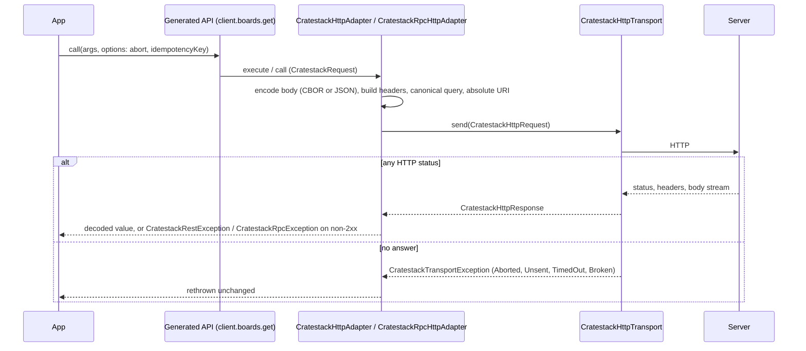

# Dart HTTP transport

*(Since 0.16.0, [cratestack#1204](https://github.com/cratestack/cratestack/issues/1204); the `*DioAdapter` classes this replaces are the shipped surface through 0.15.4. Upgrading from them is a one-line change per adapter, see [Migrating the Dart client to the HTTP transport](/overview/migrating-dart-http-transport).)*

Every package `cratestack generate-dart` writes sends through one small interface, `CratestackHttpTransport`. It sits under the two adapter interfaces the generated client already depended on, `CratestackClientAdapter` (REST) and `CratestackRpcAdapter` (RPC). Dio is one implementation of it. fespalier's `HttpTransport` is another (see [The `fespalier` preset](/guides/dart-fespalier-preset)), and an app can write its own.

The seam is pure Dart and carries no dependency, so the generated package no longer forces a Dio on an app that sends some other way: its own client, request signing over the final bytes, a captive-portal check, HTTP spans.



The adapter owns the codec work, the headers, the dispatch on the answer's `Content-Type` and the error mapping. The transport owns the connection, and with it retries, deadlines and interception.

## The seam

Declared in the generated `lib/src/runtime.dart` of every package:

| Type | Role |
|---|---|
| `CratestackHttpTransport` | `Future<CratestackHttpResponse> send(CratestackHttpRequest request)`. The only method a transport implements. |
| `CratestackHttpRequest` | `method` (upper case), absolute `uri` (query included), `headers`, `body` (the exact bytes, or `null`), `abort` (`Future<void>?`) and `extra` (`Map<String, Object?>`, attributes that are never sent on the wire). |
| `CratestackHttpResponse` | `status`, `headers` (names lower-cased), `body` (a `Stream<Uint8List>`, readable once) and `bytes()` to read it whole. `CratestackHttpResponse.buffered(...)` builds one from bytes, handy in tests. |
| `CratestackTransportException` | The sealed base of every failure that produced no answer. Each kind carries the stack-specific `cause`. |

The contract a transport honours:

- **Resolve with the response for every HTTP status.** A 4xx or 5xx answer is not an error at this layer; the adapter maps it.
- **Fail with a `CratestackTransportException` when there is no answer**, never with a stack-specific type.
- **Send `request.body` exactly as given**, so a signer layered above sees the bytes that go out, and add no header the request does not carry beyond what the platform adds itself.

## One adapter per protocol

`CratestackHttpAdapter` (REST) and `CratestackRpcHttpAdapter` (RPC) are written once over the seam. Both take a transport, a `baseUri` and a `format`:

```dart
final adapter = CratestackHttpAdapter(
  CratestackDioTransport(dio),
  baseUri: Uri.parse('https://api.example.com'),
  // format: CratestackWireFormat.cbor,   // the default
  // useRustTransport: false,             // REST only
);

final client = BlogClientCratestackClient(adapter, basePath: '/cstack');
```

```dart
final adapter = CratestackRpcHttpAdapter(
  CratestackDioTransport(dio),
  baseUri: Uri.parse('https://api.example.com'),
  format: CratestackWireFormat.json,
);
```

- **`baseUri`** is the scheme, authority and optional path prefix every request path is joined onto: `https://api.example.com` or `https://example.com/v1`. A prefix is kept. It replaces `dio.options.baseUrl`, which the transport no longer reads.
- **`format`** is `CratestackWireFormat.cbor` (the default) or `CratestackWireFormat.json`. It sets the request body format and the `Accept` preference. The answer is always decoded by its own `Content-Type`, so an adapter set to one format still reads the other. A response of an unsupported `Content-Type` is a `FormatException` on the JSON REST adapter too; it used to hand back the raw string.
- **`useRustTransport`** (REST only) marks every request with `cratestackUseRustTransportExtraKey` in `CratestackHttpRequest.extra`, for a host interceptor that routes marked requests through the Rust runtime. It is never a header.
- **`cborSeqDecoder`** (RPC only) swaps the boundary scanner that `stream()` uses; see [Streaming](#streaming).

The CBOR codec is the native `cratestack_cbor` by default, or `package:cbor` under `--no-native-cbor`. See [The CBOR codec](/guides/dart-client-generation#the-cbor-codec). The wire output is unchanged by the move to the seam.

## Dio is one transport

`CratestackDioTransport(dio)` lives in its own generated file, `lib/src/dio_transport.dart`, the only file in `lib/src/` that names Dio. The `default` and `riverpod` presets emit it and keep `dio` in their pubspecs; the [`fespalier` preset](/guides/dart-fespalier-preset) emits neither.

It wraps the `Dio` you already have, so interceptors, base headers, certificate pinning and retry keep working. It sends with `ResponseType.stream` and `validateStatus: (_) => true`, copies `extra` into `Options.extra`, and cancels through a `CancelToken`, including while the body is still streaming. It maps Dio's failures onto the transport kinds:

| Dio failure | Transport exception |
|---|---|
| connect timeout, refused connection, DNS failure, certificate failure | `CratestackTransportUnsent` |
| send or receive timeout | `CratestackTransportTimedOut` |
| cancel | `CratestackTransportAborted` |
| anything else | `CratestackTransportBroken` |

Because the adapter sends an absolute URI, an interceptor that reads `options.path` now sees an absolute URI.

## Errors

Three families, and they do not overlap:

| Situation | REST | RPC |
|---|---|---|
| The server answered with an error status | `CratestackRestException{status, body}` | `CratestackRpcException` (`status`, `code`, `message`, `details`), unchanged |
| No answer at all | `CratestackTransportException` | `CratestackTransportException` |

`CratestackRestException.body` is the decoded error body (CBOR or JSON), the text of a body of any other `Content-Type`, or `null` when there was none or it did not decode. Before this change REST had no typed remote error at all and a raw `DioException` leaked out of `execute`.

*(Since 0.17.1, [cratestack#1243](https://github.com/cratestack/cratestack/issues/1243).)* Both exceptions also take the answer's `headers` and type an `AuthProvider` refusal: `CratestackRestException` gains `code`, `message` and `details` getters over `body`, and both expose `extra` (every member of the body but those three, never dropped) and `challenges` (the `WWW-Authenticate` value, raw; the seam joins two header lines with `, `, so they arrive as one entry). `RpcErrorBody` gains `extra`. See [Reading a refusal in a generated client](/guides/auth-provider#reading-a-refusal-in-a-generated-client). *(Since 0.17.1, [cratestack#1244](https://github.com/cratestack/cratestack/issues/1244).)* Both exceptions also expose `stepUp`, a typed `StepUpRequired` for a step-up refusal, and the runtime exports `retryAfterStepUp(call, reprove)`, which sends a call again at most once after a re-proof. See [A step-up refusal in a generated client](/guides/auth-provider#a-step-up-refusal-in-a-generated-client). A call retried with the same `idempotencyKey` gets the recorded `401` back on 0.17.1 ([cratestack#1261](https://github.com/cratestack/cratestack/issues/1261), open).

`CratestackTransportException` is sealed, with four kinds:

| Kind | Meaning | Safe to resend? |
|---|---|---|
| `CratestackTransportAborted` | The caller cancelled through `abort`. | n/a |
| `CratestackTransportUnsent` | The request provably never left the device: connection refused, host did not resolve, connect timed out, or TLS failed before any request byte was written. | Always, even a non-idempotent call. |
| `CratestackTransportTimedOut` | A deadline expired after the request may have left. | Only with an `idempotencyKey`; the server may have acted. |
| `CratestackTransportBroken` | Anything else without an answer: a dropped connection mid-request or mid-body, a malformed response. | Only with an `idempotencyKey`; the server may have acted. |

Because the type is sealed, a `switch` over a caught `CratestackTransportException` is exhaustive:

```dart
try {
  final board = await client.boards.get(7);
} on CratestackRestException catch (e) {
  // The server said no: e.status, e.body.
} on CratestackTransportException catch (e) {
  switch (e) {
    case CratestackTransportAborted():
      break; // the caller gave up
    case CratestackTransportUnsent():
      // never left the device: resend freely
    case CratestackTransportTimedOut() || CratestackTransportBroken():
      // may have been applied: resend only with an idempotency key
  }
}
```

Code that used to catch `DioException` around a generated call now catches `CratestackRestException` or `CratestackRpcException` for an error answer and `CratestackTransportException` for the rest. `on CratestackRestException` means "the server said no" and nothing else.

## Call options

`CratestackCallOptions` (REST) and `CratestackRpcCallOptions` (RPC) now carry the same three fields:

| Field | Meaning |
|---|---|
| `headers` | Extra request headers; they win over the adapter's own. |
| `idempotencyKey` | Sent as `Idempotency-Key`, so a retried mutation is applied once. RPC already had it; REST gains it. See [Idempotency](/guides/idempotency). |
| `abort` | A `Future<void>?`. Completing it cancels the call, whether it is connecting, uploading, waiting or streaming the body, and the call throws `CratestackTransportAborted`. New on both protocols. |

```dart
final cancel = Completer<void>();
final future = client.boards.create(
  input,
  options: CratestackCallOptions(
    abort: cancel.future,
    idempotencyKey: 'create-board-42',
  ),
);
cancel.complete(); // the call throws CratestackTransportAborted
```

## Streaming

`CratestackRpcHttpAdapter.stream()` no longer buffers the body. It reads an `application/cbor-seq` answer as it arrives, through `CborSeqStreamTransformer`, so frames are delivered before the body ends. It ships a pure-Dart `CratestackCborSeqScanner` as the default boundary scanner. Pass a `CborSeqDecoderHandle` factory as `cborSeqDecoder:` to use another, such as an FFI-backed one.

A final `Tag(48900, RpcErrorBody)` item is the in-band stream error and becomes a `CratestackRpcException`. A server that answers with the single-array `application/cbor` or a JSON answer is still read. See [RPC transport](/guides/rpc-transport) for the server side of streaming.

## Query encoding

A canonical query encoder, `cratestackCanonicalizeQuery`, now builds the REST query string, so no HTTP client's own list or null rules apply:

- pairs go out in map order, with keys and values through `Uri.encodeQueryComponent`;
- a list repeats its key, `tag=a&tag=b`;
- a nested map nests with literal brackets, `filter[kind]=x`;
- every other value is its `toString()`, percent-encoded (a double such as `1e+21` goes out as `1e%2B21`, so the `+` of the exponent survives);
- **a `null` value is omitted.** Dio sent a bare `key`.

For every value the generated query builders emit, the output is byte-identical to what Dio produced. The `null` rule is the one behavioural change, and it only matters to code that put a `null` into a hand-built query map.

## Writing your own transport

Implement `send`. Resolve for every status, throw a `CratestackTransportException` when there is no answer, and honour `request.abort`:

```dart
class MyTransport implements CratestackHttpTransport {
  @override
  Future<CratestackHttpResponse> send(CratestackHttpRequest request) async {
    // request.method, request.uri, request.headers, request.body (the exact
    // bytes to send), request.abort (completes when the caller gives up),
    // request.extra (attributes that are not sent on the wire).
    throw UnimplementedError();
  }
}

final adapter = CratestackRpcHttpAdapter(
  MyTransport(),
  baseUri: Uri.parse('https://api.example.com'),
);
```

## Known gaps

- Call options cannot carry transport attributes. `CratestackHttpRequest.extra` exists and a transport forwards it, but neither `CratestackCallOptions` nor `CratestackRpcCallOptions` can fill it, so a single call cannot tell the transport chain under it something that is not a header. Tracked in [cratestack#1207](https://github.com/cratestack/cratestack/issues/1207).
- An `AuthProvider` refusal cannot shape its response body. The generated handler encodes any auth error as the standard `{code, message}` envelope, so a client cannot distinguish refusal reasons by a body member. Tracked in [cratestack#1208](https://github.com/cratestack/cratestack/issues/1208).

## See also

- [The `fespalier` preset](/guides/dart-fespalier-preset) — the Riverpod surface over fespalier's `HttpTransport`, with no Dio
- [Migrating the Dart client to the HTTP transport](/overview/migrating-dart-http-transport)
- [Dart client generation](/guides/dart-client-generation) — presets, flags and the Riverpod surface
- [Client Runtime](/architecture/client-runtime) — how the Dio-direct and FFI-bridge paths relate
